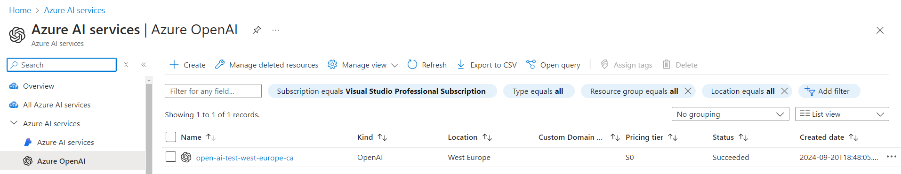
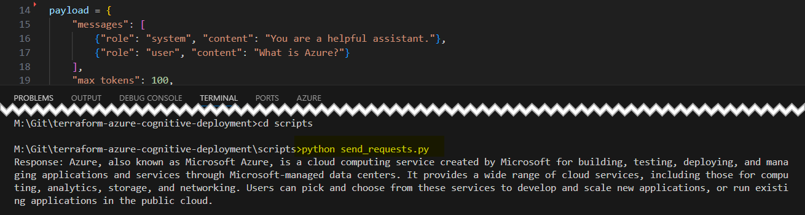
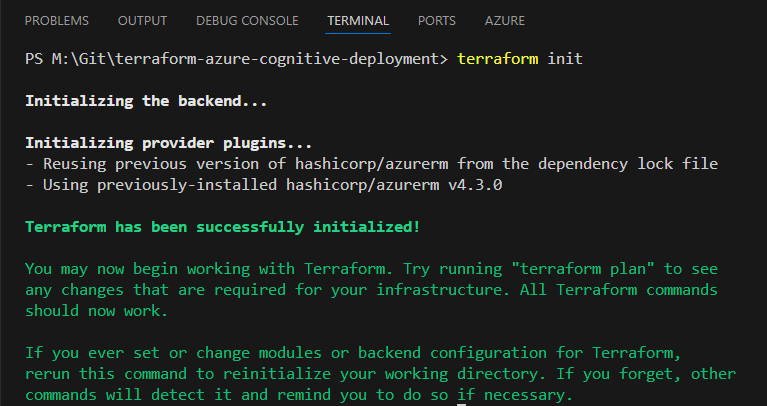
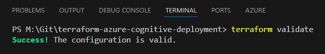
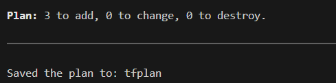
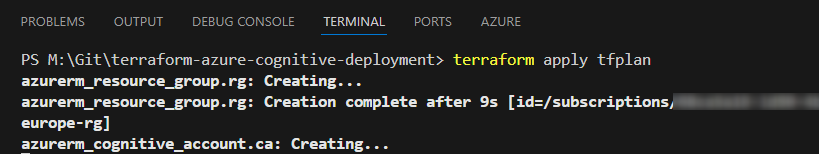
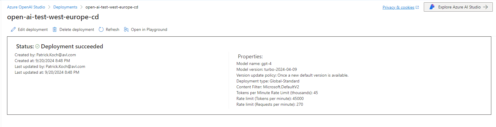
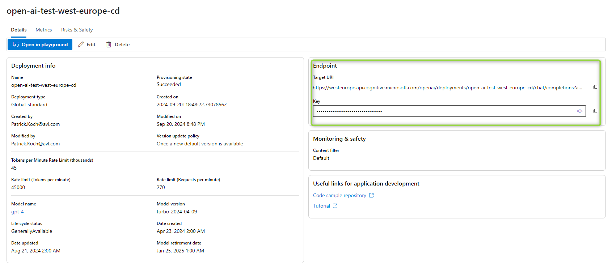
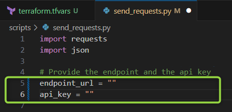

# GitHub Action Workflow

Current state of the workflow execution:

[](https://github.com/patkoch/terraform-azure-cognitive-deployment/actions/workflows/deploy-open-ai-service.yml)

Manual runs deploy or destroy the resources. Both jobs use the `production` GitHub
environment, so each needs the approval configured there. Add Required reviewers under
Settings > Environments > production; the repository files cannot enforce this.
Manual runs share a `concurrency` group and queue instead of running in parallel.
GitHub keeps only one waiting run per group, so a newer waiting run replaces an older one.


# Contains a Terraform configuration to provision a cognitive deployment on Azure

This [Terraform](https://www.terraform.io/) configuration is capable of deploying an Azure Open AI Service and a `gpt-5` model (region `swedencentral`, see [Azure Foundry model/region support](https://learn.microsoft.com/en-us/azure/foundry-classic/agents/concepts/model-region-support?tabs=global-standard)).
After the deployment, it is possible to conduct a chat by using a Python script with the generated API_Key and a public Endpoint.

<p align="left">
  
</p>

<p align="left">
  
</p>

# Copilot Skills for this repository

Repository rules, agent roles, and reusable procedures are deliberately separate.

## Shared rules

[Repository instructions](.github/copilot-instructions.md) link to
[root Terraform rules](.github/instructions/terraform-root.instructions.md),
[security rules](.github/instructions/terraform-security.instructions.md), and
[documentation rules](.github/instructions/documentation.instructions.md).
These apply independently of the agent selected in VS Code.

AzureRM always uses the pessimistic operator `~>`; its current constraint is
`~> 5.10`. Agents must preserve the version number and precision unless you
explicitly request an AzureRM upgrade. Terraform stays `~> 1.16.4`, and the
existing Azure Storage remote backend remains unchanged. Root Terraform consumes tagged
modules only; resources are implemented in the separate `terraform-modules` repo.
Configurable module inputs are variables or module outputs. Literal sources and
stable instance keys are structural exceptions. Only `resource_group_tags` may
have a default, exactly `{ ManagedBy = "Terraform" }`.

## Agents

| Agent | Role |
| --- | --- |
| [Terraform Developer](.github/agents/terraform-developer.agent.md) | Implements root configuration/workflow changes, updates documentation, runs checks, and can query the `azure-model-region` MCP tools. |
| [Terraform Reviewer](.github/agents/terraform-reviewer.agent.md) | Read-only review of changes, shared rules, and the sanitized preflight report; read-only MCP lookups, no terminal or editing tools. |

Select the agent in VS Code's agent picker. The Developer offers a manual
handoff to the Reviewer. No agent may apply without your explicit consent for
the reviewed plan and target environment. Only the Developer can apply after
that consent; the Reviewer stays read-only. A request to edit, upgrade, or check
does not authorize deployment. New plans or changed inputs require fresh consent.
Preflight, upgrade, and review skills never apply automatically. Neither agent
runs destroy or state mutations. The rule also covers deployment workflow dispatches.
Module development is a separate task in the module repository, not an agent here.

For example, after reviewing a plan: "I explicitly authorize Terraform Apply
for this reviewed saved plan in the stated target environment." If permission
is ambiguous, the Developer must ask and wait. See
[Explicit Apply Consent](.github/copilot-instructions.md#explicit-apply-consent).

## Skills

| Skill | Procedure | Example prompt |
| --- | --- | --- |
| [terraform-preflight](.github/skills/terraform-preflight/SKILL.md) | Runs `scripts/preflight.py`: policy and secret checks, TFLint, fmt, validate, plan; writes the sanitized report `.preflight/report.md`. | "Run terraform-preflight and report passed, failed, and blocked checks." |
| [terraform-plan-review](.github/skills/terraform-plan-review/SKILL.md) | Reviews the plan section of that report without generating another plan; reports replacement/deletion, security, and cost risks. | "Review the preflight report's plan and prepare a PR summary." |
| [terraform-doc-sync](.github/skills/terraform-doc-sync/SKILL.md) | Checks README against configuration, inputs, workflows, and customizations. | "Synchronize the README with my Terraform changes." |
| [terraform-azurerm-upgrade](.github/skills/terraform-azurerm-upgrade/SKILL.md) | Explicitly authorized provider upgrades only; clarifies target and precision, checks compatibility, and runs preflight. | "Please upgrade AzureRM to my specified target, keeping the `~>` operator." |
| [terraform-model-change](.github/skills/terraform-model-change/SKILL.md) | Verifies model, version, and region with the `azure-model-region` MCP tools before editing tfvars; flags replacement risks. | "Switch the deployment to `<model>` in `<region>`." |

For "please upgrade AzureRM" without a target, the Developer asks which version
you want before editing. It never upgrades automatically during other tasks.
`~> X.Y` allows versions below the next major; `~> X.Y.Z` allows versions below
the next minor. Changing precision also requires agreement. A separate upgrade
agent is not necessary: the Developer loads this narrowly scoped skill on request.

Changes to Terraform or its workflow require the full preflight. Customization-only
changes require frontmatter, link, and consistency checks, not a cloud plan.
Missing tools, credentials, or backend access mean blocked, not passed.

The Developer requires a current saved plan for Terraform/workflow changes;
static checks or an older plan are not sufficient. Before remote backend access,
it checks authentication and the intended subscription. For local CLI use, run
`az login` if no valid session exists and supply `TF_VAR_subscription_id` for the
confirmed target. An `export` in the VS Code integrated terminal may not be
inherited by the agent's command process. After confirming that the active CLI
subscription is the intended target, the Developer scopes the ID to the
preflight process without printing or persisting it. Approved OIDC or managed
identity authentication does not need an interactive login. Backend and
deployment permissions are also required.
The Developer creates `.venv-checks` and installs the pinned policy Python
dependencies from `scripts/requirements-checks.txt` there if missing. This
repository-local setup does not require another confirmation. External tools,
credentials, and access are not installed or bypassed automatically.

`python3 scripts/preflight.py` runs the preflight and writes `.preflight/report.md`
(gitignored): step statuses, plan counts with resource addresses and changed attribute
names (never values), changed files, and the diff against HEAD. The Reviewer has no
terminal and reads this report instead, so run the preflight after your last edit.
The report cannot prove its own freshness; it records the revision and a worktree fingerprint.

## Automated policy and secret checks

The [Terraform Policy workflow](.github/workflows/terraform-policy.yml) runs
without Azure credentials. Its [HCL policy checker](scripts/check_terraform_policy.py)
enforces versions, backend, module sources/composition, parameterization, the
defaults allowlist, and non-sensitive declared tfvars inputs. It also requires every
workflow job that runs `terraform apply` or `destroy` to use an environment, and such
workflows to keep a non-cancelling top-level `concurrency`. Gitleaks complements the
structural checks by scanning for secrets; no scanner proves their complete absence.
The AzureRM check enforces `~>` without hardcoding a version number. It cannot
verify prompt authorization; agent instructions and human review govern that.

Set up the local Python environment and run the policy checker and its regression
tests:

```bash
python3 -m venv .venv-checks
source .venv-checks/bin/activate
pip install -r scripts/requirements-checks.txt
python scripts/check_terraform_policy.py
python -m unittest discover -s scripts -p 'test_*.py'
gitleaks dir . --redact --no-banner
python scripts/preflight.py
```

The Terraform Developer reuses `.venv-checks` and installs the pinned Python
dependencies there automatically if they are missing. TFLint and Gitleaks must
be installed separately. CI uses TFLint `0.61.0` and
Gitleaks `8.24.3`. Configure the policy job and deployment verification as required
checks in GitHub branch protection; a workflow file alone does not enforce merging.
The provider lockfile should be committed after successful initialization; routine
checks must not use `terraform init -upgrade`. Dependency upgrades are separate tasks.
Treat saved plans/state as sensitive and never post unsanitized output publicly.

# MCP server for Azure model / region lookup

This repository ships a small [Model Context Protocol](https://modelcontextprotocol.io)
server under [`mcp-server/`](./mcp-server) that an MCP-aware client (e.g.
GitHub Copilot, Claude Desktop, Continue) can connect to in order to query
which Azure regions support which Azure OpenAI / Foundry models.

## Purpose

The Azure region/model support matrix is published on Microsoft Learn and
changes regularly (new models, new regions, deprecations):

<https://learn.microsoft.com/en-us/azure/foundry-classic/agents/concepts/model-region-support?tabs=global-standard>

Whenever you want to point this repository at a different model — for
example switching from `gpt-4o` to `gpt-5` — you need to know two things:

1. Which Azure regions support the target model on `GlobalStandard`?
2. Which `model_version` string is currently GA for that model?

Looking that up by hand is slow and error-prone. The MCP server automates
it: it fetches and parses the Microsoft Learn page on demand (1 h cache),
and exposes the result through three tools so that an agent can pick a
valid combination and even produce a ready-to-paste
`terraform.auto.tfvars` snippet.

If the Microsoft Learn page is unreachable (offline runner, restricted
egress) the server transparently falls back to a small built-in table
shipped in `mcp-server/server.py`. Every response carries a `source`
field (`"live"` or `"fallback"`) so the caller can tell which data was
used.

## Exposed tools

| Tool                          | Input                | What it returns                                                                              |
| ----------------------------- | -------------------- | -------------------------------------------------------------------------------------------- |
| `list_regions_for_model`      | `model_name: str`    | Azure region short names that support the model (e.g. `["eastus2", "swedencentral"]`)        |
| `list_models_for_region`      | `region: str`        | Models available in the given region                                                         |
| `get_recommended_tfvars`      | `model_name: str`    | A paste-ready snippet for `terraform.auto.tfvars` (region + names + `model_version` + SKU); the region is only the first supported one, so choose your own   |

## Enable the MCP server

The server is a standard stdio MCP server written in Python.

### 1. Install dependencies

```bash
cd mcp-server
python -m venv .venv
source .venv/bin/activate
pip install -r requirements.txt
```

### 2. Register it with your MCP client

In VS Code this repository already registers the server in `.vscode/mcp.json`, so
step 1 is all you need. The Terraform Developer and Reviewer agents list its tools,
and the [terraform-model-change](.github/skills/terraform-model-change/SKILL.md)
skill uses them. `requirements.txt` pins `mcp<2` because the server uses the 1.x
`FastMCP` API, which 2.x renamed.

For another client, add an entry like the following to its MCP configuration (path
depends on the client — e.g. `~/.config/Claude/claude_desktop_config.json`,
the VS Code `mcp.json`, or Copilot's MCP settings):

```json
{
  "mcpServers": {
    "azure-model-region": {
      "command": "/absolute/path/to/mcp-server/.venv/bin/python",
      "args": ["/absolute/path/to/mcp-server/server.py"]
    }
  }
}
```

Restart the client. The three tools above should now appear under the
`azure-model-region` server.

### 3. (Optional) Run it manually

For a quick sanity check you can also start it directly:

```bash
python mcp-server/server.py
```

It will wait for MCP JSON-RPC messages on stdin/stdout.

## Usage example

Ask your agent something like:

> *"I want to deploy `gpt-5`. Which Azure region should I use, and what
> values do I need in `terraform.auto.tfvars`?"*

A capable agent will call the MCP tools in sequence. Abbreviated example (the live
list currently has 21 regions for `gpt-5`):

```text
> list_regions_for_model("gpt-5")
{
  "model": "gpt-5",
  "regions": ["australiaeast", "brazilsouth", "...", "swedencentral", "...", "westus3"],
  "source": "live",
  "reference": "https://learn.microsoft.com/.../model-region-support?tabs=global-standard"
}

> get_recommended_tfvars("gpt-5")
{
  "model": "gpt-5",
  "region": "australiaeast",
  "model_version": "2025-08-07",
  "tfvars_snippet": "resource_group_name     = \"gpt-5-australiaeast-rg\"\n..."
}
```

`get_recommended_tfvars` suggests the first supported region alphabetically, not the
best one for you. Pick your region from `list_regions_for_model` and use the snippet
only as a hint for `model_version`; the
[terraform-model-change](.github/skills/terraform-model-change/SKILL.md) skill
follows exactly this approach before it edits `terraform.auto.tfvars`.

For more details (parsing logic, fallback table, how to extend) see
[`mcp-server/README.md`](./mcp-server/README.md).

# Prepare the deployment inputs

Edit the existing `terraform.auto.tfvars` at the repository root. Do not create
a competing `terraform.tfvars` file. This file contains non-sensitive deployment
values only; the current model configuration is:

```hcl
resource_group_name = "open-ai-test-sweden-central-rg"
resource_group_location = "swedencentral"
resource_group_tags = {
  Project = "OpenAI-Test"
  Environment = "Test"
  ManagedBy = "Terraform"
}
cognitive_account_name = "open-ai-test-sweden-central-ca"
cognitive_account_kind = "OpenAI"
cognitive_account_sku_name = "S0"
cognitive_account_custom_subdomain_name = "open-ai-test-sweden-central"
cognitive_account_identity_type = "SystemAssigned"
cognitive_account_local_auth_enabled = true
cognitive_account_public_network_access_enabled = true
cognitive_account_tags = {
  Project = "OpenAI-Test"
  Environment = "Test"
  Service = "OpenAI"
  ManagedBy = "Terraform"
}
cognitive_deployment_name = "open-ai-test-sweden-central-cd"
cognitive_deployment_model_format = "OpenAI"
cognitive_deployment_model_name = "gpt-5"
cognitive_deployment_model_version = "2025-08-07"
cognitive_deployment_sku_name = "GlobalStandard"
cognitive_deployment_sku_capacity = 50
cognitive_deployment_version_upgrade_option = "OnceNewDefaultVersionAvailable"
```

Before running Terraform, sign in with Azure CLI (`az login`) if you do not
already have a valid session. Select the intended subscription, then set
`TF_VAR_subscription_id` in the same terminal where you will run Terraform.
The preflight uses this value to target the selected subscription. This export
applies to commands launched from that terminal; a VS Code agent may run in a
separate process and not inherit it. For agent-run preflight, after confirming
the active CLI subscription is the intended target, the Developer scopes the
variable to the preflight command instead.
Never add API keys or credentials to tfvars.

```bash
az login
az account set --subscription "<target-subscription-id>"
export TF_VAR_subscription_id="$(az account show --query id -o tsv)"
```

All inputs except `resource_group_tags` are required. The checked-in file explicitly
sets identity, upgrade policy, and both authentication/network flags. Their current
`true` values preserve existing behavior, not a security recommendation.

# Deploy the resources using Terraform

Start a new terminal, change the directory of the checked out directory of the repository.

Initialize dependencies against the configured remote backend without upgrading
them. Then follow the quality gates in order: TFLint, fmt, validate, plan.
The apply and destroy commands below are manual operations, not agent actions.

## Terraform init

```hcl
terraform init
```

<p align="left">
  
</p>

## Terraform validate

Before validation, run linting and formatting:

```bash
tflint --init
tflint --format=compact
terraform fmt -recursive
terraform fmt -check -recursive
```

```hcl
terraform validate
```

<p align="left">
  
</p>

## Terraform plan

```hcl
terraform plan -input=false -out=tfplan
```

<p align="left">
  
</p>

## Terraform apply

```hcl
terraform apply tfplan
```

<p align="left">
  
</p>

This deploys the configured account `open-ai-test-sweden-central-ca`.
The screenshots below illustrate an older West Europe / GPT-4 deployment:

<p align="left">
  
</p>

and its model deployment (the current configuration uses `gpt-5`):

<p align="left">
  
</p>

You can change the type of the deployment by adapting the following values:

```hcl
cognitive_deployment_model_format = "OpenAI"
cognitive_deployment_model_name = "gpt-5"
cognitive_deployment_model_version = "2025-08-07"
cognitive_deployment_sku_name = "GlobalStandard"
```

Check at [Azure OpenAI Service models](https://learn.microsoft.com/en-us/azure/ai-services/openai/concepts/models) which model fits for you also regarding your prefered region.

The checked-in configuration uses `gpt-5` version `2025-08-07` in `swedencentral`.
Verify current model availability and subscription quota before deployment.

# Conduct prompts and get a response

## Get the endpoint credentials

You need to get the following information of the endpoint to establish a connection to the service:

 * the API Key
 * the Target URI

Explore the Details of the deployment to find that data:

<p align="left">
  
</p>

## Use a python script to send the requests

Insert the mentioned information in the lines 5, respectively 6 in the file "/scripts/send_requests.py":

<p align="left">
  
</p>

Afte that, call the file using Python like:

<p align="left">
  
</p>

# Destroy the resources

If there is no need any more, then destroy the resources using:

```hcl
terraform destroy
```

In GitHub Actions, run the workflow with the action `destroy`. Like a deploy, it waits
for the approval of the `production` environment.

# References

The code of this example was partially created with the GitHub Copilot, respectively I used also the following examples and documentation of HashiCorp and Microsoft:

[Terraform Registry - azurerm_cognitive_account](https://registry.terraform.io/providers/hashicorp/azurerm/latest/docs/resources/cognitive_account)

[Azure OpenAI Service models](https://learn.microsoft.com/en-us/azure/ai-services/openai/concepts/models)